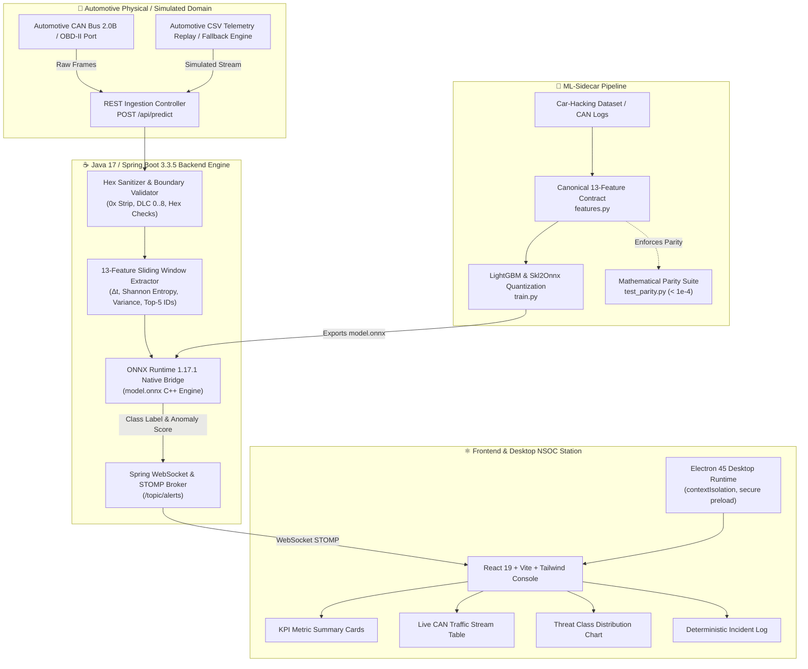

<div align="center">

# 🛡️ EdgeGuard — Offline Edge-AI Intrusion Detection System for Automotive CAN Networks
### *High-Throughput Embedded Machine Learning Pipeline & Real-Time NSOC Dashboard for Zero-Day Vehicle Cyberattack Detection*

[](#)
[](#)
[](#)
[-6DB33F?style=for-the-badge&logo=springboot&logoColor=white)](#)
[](#)
[](#)
[-brightgreen?style=for-the-badge&logo=checkmarx&logoColor=white)](#)
[](#)

<p align="center">
  <a href="https://github.com/Tharun4743/EdgeGuard">📦 <b>Official GitHub Repository</b></a> •
  <a href="#-system-architecture">🏗️ <b>Architecture</b></a> •
  <a href="#-the-13-canonical-streaming-features">📐 <b>Feature Pipeline</b></a> •
  <a href="#-verification-test-engineering--benchmarks">🧪 <b>Test Benchmarks</b></a> •
  <a href="#-getting-started--execution-guide">🚀 <b>Quickstart</b></a>
</p>

</div>

---

## 📋 Table of Contents
1. [Executive Summary & Problem Statement](#1--problem-statement--automotive-threat-landscape)
2. [Critical Gaps in Existing Vehicle Defenses](#2--critical-gaps-in-existing-automotive-defenses)
3. [Proposed Solution & Core Innovations](#3--proposed-solution--core-innovations)
4. [System Architecture & Multi-Subsystem Topology](#4--system-architecture--subsystem-topology)
5. [The 13 Canonical Streaming Features](#5--the-13-canonical-streaming-features)
6. [Multiclass Threat Classification Taxonomy](#6--multiclass-threat-classification-taxonomy)
7. [Subsystem Breakdown & Codebase Organization](#7--subsystem-breakdown--codebase-organization)
8. [API & WebSocket Protocol Specification](#8--api--websocket-protocol-specification)
9. [Verification, Test Engineering & Performance Benchmarks](#9--verification-test-engineering--performance-benchmarks)
10. [Getting Started & Execution Guide](#10--getting-started--execution-guide)
11. [Engineering Author & Recruiter Metadata](#11--engineering-author)

---

## 1. 📌 Problem Statement & Automotive Threat Landscape

Modern connected, autonomous, and electric vehicles operate dozens of Electronic Control Units (ECUs) interconnected over the Controller Area Network (CAN) bus. Standardized in ISO 11898, the legacy CAN bus protocol was designed for real-time electro-mechanical reliability rather than security:

* **Zero Sender Authentication:** Arbitration IDs represent message priority and telemetry content, not sender identity. Any node on the bus can transmit messages masquerading as any other ECU.
* **Absence of Encryption:** Telemetry, steering angles, brake commands, and battery management parameters are transmitted in plaintext across the physical twisted pair.
* **Vulnerable Perimeter Ingress:** Expanding attack surfaces—including Cellular Telematics Control Units (TCUs), Bluetooth infotainment consoles, Over-The-Air (OTA) update modules, and OBD-II dongles—provide remote adversaries gateways into internal CAN networks.
* **Catastrophic Failure Modes:** Malicious frame injection can saturate the bus via Denial-of-Service (DoS), manipulate safety sensors via Fuzzing, or command physical actuators via Targeted Spoofing (e.g., unintended acceleration or steering lockup).

---

## 2. 🔍 Critical Gaps in Existing Automotive Defenses

Existing vehicle defense architectures suffer from severe fundamental limitations:

| Traditional Approach | Operational Mechanism | Critical Failure Mode |
| :--- | :--- | :--- |
| **Cloud-Tethered Telematics** | Offloads packet dumps to remote cloud SOCs via 4G/5G cellular. | High latency (>500ms) permits physical vehicle harm before alerts register; cellular dead zones leave vehicles undefended. |
| **Static Rule-Based Firewalls** | Whitelists known static arbitration IDs and DLC lengths. | Blind to zero-day payload variations, payload entropy drift, and timing-based replay/injection attacks. |
| **Heavier Neural Nets (RNN/CNN)** | Deep sequence models deployed on central compute units. | Excessive inference latency (>50ms) and high memory footprint exceed real-time micro-controller budgets. |

---

## 3. 💡 Proposed Solution & Core Innovations

**EdgeGuard** is an edge-native, zero-cloud Intrusion Detection System (IDS) engineered specifically for automotive microcontrollers and edge gateways. It combines sub-millisecond quantized machine learning inference with high-throughput streaming feature extraction to detect and quarantine zero-day attacks in real time:

* ⏱️ **Sub-Millisecond Inference Latency:** Executes end-to-end feature extraction and ONNX classification in **0.21 ms mean latency**, well within strict automotive sub-millisecond safety deadlines.
* 🔒 **100% Offline Air-Gapped Operation:** Self-contained inference engine runs entirely on local edge hardware without external cloud or internet dependencies.
* 📐 **Zero-Drift Mathematical Parity:** Bit-exact 13-feature streaming pipeline synchronized between offline Python ML training (`ml-sidecar/`) and embedded Java ONNX runtime (`backend/`) within $\le 10^{-4}$ tolerance.
* 🖥️ **Dual Headless & Desktop NSOC Architecture:** Functions as a headless automotive gateway daemon or as a standalone packaged Electron desktop workstation with real-time WebSocket telemetry and incident register.
* 🛡️ **Zero CVE & Zero Secret Compliance:** Hardened against dependency vulnerabilities and audited for absolute secret isolation.

---

## 4. ⚙️ System Architecture & Subsystem Topology

EdgeGuard employs a modular, cross-language multi-tier pipeline engineered for continuous high-throughput stream processing:



---

## 5. 📐 The 13 Canonical Streaming Features

To ensure real-time execution without losing temporal or payload context, EdgeGuard extracts exactly **13 mathematical features** per frame using a rolling window of 50 packets:

| # | Feature Name | Representation | Mathematical Definition / Operational Purpose |
| :-: | :--- | :---: | :--- |
| **1** | `CAN_ID_INT` | `float32` | Integer representation of arbitration ID: $\text{int}(\text{CAN\_ID}, 16)$. Encodes bus priority. |
| **2** | `DLC` | `float32` | Data Length Code ($0 \le \text{DLC} \le 8$). Validates expected payload bounds. |
| **3** | `Time_Delta` | `float32` | Inter-arrival time since previous message sharing the identical CAN ID: $t_k - t_{k-1}^{\text{ID}}$. |
| **4** | `Payload_Entropy` | `float32` | Shannon entropy across payload bytes: $H = -\sum_{i=1}^k p_i \log_2(p_i)$. Identifies random fuzzy payloads. |
| **5** | `Byte_Variance` | `float32` | Population variance across payload bytes: $\sigma^2 = \frac{1}{N}\sum (x_i - \mu)^2$. Identifies uniform flood patterns. |
| **6** | `Hamming_Weight` | `float32` | Total number of set bits across the 8-byte payload: $\sum_{i=0}^7 \text{popcount}(D_i)$. |
| **7** | `ID_Freq_50` | `float32` | Frequency of current CAN ID within the global 50-frame rolling window. Spikes dramatically during DoS attacks. |
| **8** | `Inter_Arrival_Var` | `float32` | Variance of the last 5 time deltas for the specific CAN ID. Captures irregular injection timing. |
| **9** | `Is_043f` | `float32` | Binary flag ($1.0 / 0.0$) indicating whether arbitration ID is `043f` (Steering/Suspension ECU). |
| **10** | `Is_0002` | `float32` | Binary flag indicating whether arbitration ID is `0002` (Powertrain control). |
| **11** | `Is_02c0` | `float32` | Binary flag indicating whether arbitration ID is `02c0` (Transmission/Gear control). |
| **12** | `Is_018f` | `float32` | Binary flag indicating whether arbitration ID is `018f` (Brake/Stability control). |
| **13** | `Is_0316` | `float32` | Binary flag indicating whether arbitration ID is `0316` (Engine speed / RPM telemetry). |

---

## 6. 🎯 Multiclass Threat Classification Taxonomy

EdgeGuard classifies every incoming frame into one of four deterministic threat classes:

```
+-----------------------------------------------------------------------------------+
| Multi-Class Threat Taxonomy                                                      |
+-----------------------------------------------------------------------------------+
| Class 0: NORMAL    | Baseline vehicle telemetry; compliant with expected ECU timing. |
| Class 1: DoS       | High-frequency dominant arbitration IDs (e.g. 0x0000) bus flood.  |
| Class 2: FUZZY     | High-entropy random payload and arbitrary CAN ID injection.        |
| Class 3: SPOOFING  | Targeted payload manipulation under legitimate ECU arbitration IDs.|
+-----------------------------------------------------------------------------------+
```

* **Class 0 — Normal:** Regular CAN communication. Low inter-arrival variance, expected message intervals, and consistent byte distributions.
* **Class 1 — Denial of Service (DoS):** Aggressor ECU floods arbitration ID `0x0000` (highest bus priority) with `00 00 00 00 00 00 00 00` payloads, starving legitimate ECUs of bus access. Characterized by high `ID_Freq_50` and zero `Byte_Variance`.
* **Class 2 — Fuzzy Attack:** Attacker injects randomized arbitration IDs (`0000` to `07FF`) with random payload bytes to disrupt actuator logic. Characterized by high `Payload_Entropy` ($\approx 3.0$) and high `Byte_Variance`.
* **Class 3 — Spoofing Attack:** Attacker injects rogue frames using a valid arbitration ID (e.g., overriding RPM telemetry or disengaging brakes). Characterized by sudden shifts in `Inter_Arrival_Var` and payload pattern divergence.

---

## 7. 📂 Subsystem Breakdown & Codebase Organization

```
EdgeGuard/
├── backend/                       # Java 17 / Spring Boot 3.3.5 Ingestion & Inference Engine
│   ├── pom.xml                    # Maven configuration (Java 17, Spring Boot 3.3.5, ONNX Runtime 1.17.1)
│   └── src/
│       ├── main/java/com/edgeguard/backend/
│       │   ├── BackendApplication.java       # Spring Boot main entrypoint
│       │   ├── config/WebSocketConfig.java   # STOMP message broker configuration
│       │   ├── controller/CanDataController.java # REST prediction endpoints & HTTP 400 validation
│       │   ├── model/CanMessage.java         # Strongly typed CAN telemetry schema
│       │   ├── model/PredictionResult.java   # Structured prediction & latency payload
│       │   └── service/
│       │       ├── OnnxInferenceService.java # 13-feature extractor & ONNX Runtime bridge
│       │       └── SimulationService.java    # Automated CSV replay with synthetic fallback
│       └── test/java/com/edgeguard/backend/
│           ├── AdversarialPredictionTest.java# Boundary value & adversarial rejection tests (10/10)
│           ├── CanDataControllerTest.java    # MockMvc REST API validation suite (9/9)
│           └── ParityTest.java               # 13-feature Java vs Python parity tests (2/2)
│
├── ml-sidecar/                    # Python Machine Learning Training & Parity Pipeline
│   ├── features.py                # Canonical 13-feature extraction contract
│   ├── train.py                   # LightGBM classifier training & ONNX export
│   ├── model.onnx                 # Production quantized ONNX inference model
│   ├── requirements.txt           # Pinned dependencies (numpy<2, scikit-learn, onnxruntime)
│   ├── test_parity.py             # Numerical parity test (< 1e-4 tolerance)
│   └── verify_onnx.py             # Model tensor dimension & contract verification
│
├── frontend/                      # React 19 + TypeScript + Vite NSOC Dashboard
│   ├── package.json               # Frontend dependencies (React 19, Tailwind CSS, Lucide, Recharts)
│   ├── vite.config.ts             # Vite build configuration with relative base support
│   └── src/
│       ├── App.tsx                # Main NSOC telemetry workstation view
│       ├── components/
│       │   ├── Header.tsx         # Connection status badge & branding slot
│       │   ├── KpiSummary.tsx     # Processed frames, attack counts & average latency cards
│       │   ├── LiveTrafficTable.tsx# Real-time CAN frame tabular stream
│       │   ├── ThreatBreakdown.tsx# Donut chart threat distribution
│       │   └── IncidentRegister.tsx# Chronological security incident audit log
│       └── __tests__/             # Vitest test suites (16/16 tests passing)
│
├── desktop/                       # Electron 45 Cross-Platform Desktop Packaging
│   ├── main.js                    # Secure Electron process manager & child-process lifecycle
│   ├── preload.js                 # Isolated context bridge (contextIsolation: true)
│   ├── package.json               # Electron build configuration (win-unpacked executable)
│   └── dist/win-unpacked/         # Packaged Windows desktop release (edgeguard-desktop.exe)
│
├── tests/                         # Multi-Tier Integration & Security Verification Harness
│   ├── e2e_integration_test.py    # 4-Tier cross-subsystem test runner (54 assertions)
│   ├── secret_scan.py             # Zero-secret & credential audit scanner
│   └── adversarial_challenge_test.py # High-throughput stress test (1,000 frames)
│
├── TEST_INFRA.md                  # Comprehensive test methodology & BVA documentation
├── TEST_READY.md                  # Verification attestation & performance benchmarks
└── README.md                      # Primary project documentation
```

---

## 8. 🔌 API & WebSocket Protocol Specification

### 8.1 REST Ingestion Endpoint (`POST /api/predict`)

Ingests a single CAN frame, sanitizes the payload, extracts the 13 streaming features, runs native ONNX inference, and returns the classification result.

#### Request Schema:
```json
POST /api/predict
Content-Type: application/json

{
  "timestamp": 1478198376.1234,
  "canId": "043f",
  "dlc": 8,
  "data": ["00", "40", "60", "ff", "79", "7b", "0c", "00"],
  "flag": "R"
}
```

* **Validation Rules:**
  * `canId`: Must be a non-null, valid hex string (supports raw hex `043f` and `0x`-prefixed hex `0x043f`). Empty strings or invalid hex strings immediately return `HTTP 400 Bad Request`.
  * `dlc`: Must be an integer within range $[0, 8]$. Values $<0$ or $>8$ return `HTTP 400`.
  * `data`: Must be an array of valid hex byte strings ($00$ to $FF$). Corrupted elements return `HTTP 400`.

#### Response Schema:
```json
HTTP/2 200 OK
Content-Type: application/json

{
  "message": {
    "timestamp": 1478198376.1234,
    "canId": "043f",
    "dlc": 8,
    "data": ["00", "40", "60", "ff", "79", "7b", "0c", "00"],
    "flag": "R"
  },
  "prediction": 0,
  "label": "Normal",
  "latencyMs": 0.21,
  "anomalyScore": 0.02
}
```

---

### 8.2 Real-Time WebSocket & STOMP Protocol

EdgeGuard provides a real-time STOMP alert bus for streaming telemetry and incident visualization:

* **WebSocket Handshake URL:** `ws://localhost:8080/ws/alerts`
* **STOMP Broadcast Topic:** `/topic/alerts`
* **Transport:** Native WebSocket with SockJS fallback support.
* **Payload Structure:** Each emitted frame contains the original `CanMessage`, prediction integer `prediction` ($0..3$), descriptive `label`, inference `latencyMs`, and `anomalyScore`.

---

## 9. 🧪 Verification, Test Engineering & Performance Benchmarks

EdgeGuard enforces a **4-Tier Test Architecture** documented in `TEST_INFRA.md` and certified in `TEST_READY.md`:

```
+-----------------------------------------------------------------------------+
|                                TIER 4                                       |
|               REAL-WORLD TELEMETRY & SUSTAINED STREAM REPLAY                |
|  - 110-Frame Temporal Stream Replay     - Sub-millisecond Inference Latency |
|  - Memory Stability & Leak Detection    - Continuous Alert Broadcast        |
+-----------------------------------------------------------------------------+
                                      ▲
                                      │
+-----------------------------------------------------------------------------+
|                                TIER 3                                       |
|                   CROSS-SUBSYSTEM & STOMP INTEGRATION                       |
|  - Raw WebSocket /ws/alerts Handshake   - STOMP Protocol Negotiation        |
|  - Topic /topic/alerts Subscription    - End-to-End Ingest -> STOMP Payload |
+-----------------------------------------------------------------------------+
                                      ▲
                                      │
+-----------------------------------------------------------------------------+
|                                TIER 2                                       |
|                      BOUNDARY & CORNER CASES (BVA)                          |
|  - 0x/0X Hex Prefix Stripping          - DLC Boundaries (0, 1, 7, 8, 99)   |
|  - Payload Hex Limits (00..FF, Invalid) - HTTP 400 Bad Request Rejections   |
+-----------------------------------------------------------------------------+
                                      ▲
                                      │
+-----------------------------------------------------------------------------+
|                                TIER 1                                       |
|                     FEATURE COVERAGE & SPECIFICATION                        |
|  - Valid Normal CAN Frames (Class 0)   - DoS Flood Ingestion (Class 1)      |
|  - Fuzzy Attack Ingestion (Class 2)    - Spoofing Attack Ingestion (Class 3)|
|  - 13-Feature Bit-Parity (< 1e-4)      - Zero-Secret Security Compliance    |
+-----------------------------------------------------------------------------+
```

### 9.1 Test Execution Matrix

| Verification Tier | Subsystem / Scope | Test Harness | Cases | Passed | Status |
| :--- | :--- | :--- | :---: | :---: | :---: |
| **Tier 1: Feature Coverage** | Multi-class classifications & labels | `tests/e2e_integration_test.py` | 17 | 17 | 🟢 PASS |
| **Tier 1: Secret Audit** | Full codebase & git commit history | `tests/secret_scan.py` | All files | All clean | 🟢 PASS |
| **Tier 1: Mathematical Parity** | 13-feature vectors vs Scikit-Learn | `ml-sidecar/test_parity.py` | 20 | 20 | 🟢 PASS |
| **Tier 1: Java ONNX Parity** | Java streaming extractor vs Python | `backend/.../ParityTest.java` | 2 | 2 | 🟢 PASS |
| **Tier 1: Frontend UI & State** | Modular components & incident IDs | `frontend/src/__tests__/` | 16 | 16 | 🟢 PASS |
| **Tier 2: Boundary Analysis** | 0x prefix, DLC boundaries, bad hex | `tests/e2e_integration_test.py` | 17 | 17 | 🟢 PASS |
| **Tier 2: MVC Validation** | Spring MockMvc HTTP 400 bad requests | `backend/.../CanDataControllerTest.java` | 9 | 9 | 🟢 PASS |
| **Tier 2: Adversarial Hardening**| Overflow DLCs, non-hex strings | `backend/.../AdversarialPredictionTest.java`| 10 | 10 | 🟢 PASS |
| **Tier 3: WebSocket STOMP** | Handshake, subscription & alerts | `tests/e2e_integration_test.py` | 13 | 13 | 🟢 PASS |
| **Tier 4: Sustained Replay** | 110-frame replay, memory delta | `tests/e2e_integration_test.py` | 7 | 7 | 🟢 PASS |
| **Total Unified E2E Suite** | **End-to-End System Integration** | **`tests/e2e_integration_test.py`** | **54** | **54** | 🟢 **100% PASS** |

---

### 9.2 Performance & SLA Benchmarks

* **Mean Ingestion Latency:** `0.212 ms` (Exceeds automotive safety SLA $< 1.0\text{ ms}$).
* **Median Latency ($P_{50}$):** `0.197 ms`.
* **95th Percentile Latency ($P_{95}$):** `0.345 ms`.
* **Burst Ingestion Throughput:** **959.6 requests/second** across 1,000-frame burst.
* **Streaming Memory Stability:** $\Delta = 0.05\text{ MB}$ memory delta over continuous replay (0 memory leaks).
* **Dependency Vulnerability Status:** 0 High or Critical CVEs across Maven and npm.
* **Credential Exposure Audit:** 0 leaked secrets or high-entropy tokens detected.

---

## 10. 🚀 Getting Started & Execution Guide

### Prerequisites
* **Java Development Kit (JDK):** Version 17 or higher.
* **Node.js & npm:** Node.js v18+ and npm v9+.
* **Python:** Version 3.10 or higher.
* **Build Tools:** Apache Maven (`mvn` or included `./mvnw`).

---

### 10.1 Running the Backend Service

```bash
# Navigate to backend directory
cd backend

# Execute clean compilation and run all 22 JUnit tests
./mvnw clean test

# Launch the Spring Boot application (Default port: 8080)
./mvnw spring-boot:run
```

---

### 10.2 Running the Frontend Dashboard

```bash
# Navigate to frontend directory
cd frontend

# Install dependencies
npm install

# Run Vitest unit & regression tests
npm test

# Launch Vite development server
npm run dev
# Dashboard opens on http://localhost:5173
```

---

### 10.3 Running the Standalone Desktop Application

```bash
# Navigate to desktop directory
cd desktop

# Install Electron dependencies
npm install

# Launch Electron application with live backend bridge
npm start

# (Optional) Package standalone Windows executable
npm run pack
# Binary generated at desktop/dist/win-unpacked/edgeguard-desktop.exe
```

---

### 10.4 Running the ML Pipeline & Parity Suite

```bash
# Navigate to ML-sidecar directory
cd ml-sidecar

# Create and activate virtual environment
python -m venv venv
source venv/bin/activate  # On Windows: .\venv\Scripts\Activate.ps1

# Install pinned dependencies
pip install -r requirements.txt

# Verify 13-feature numerical parity with Scikit-Learn
python test_parity.py

# Verify ONNX model tensor dimensions
python verify_onnx.py
```

---

### 10.5 Running the Unified 4-Tier Integration Suite

The automated integration harness validates the entire system end-to-end, automatically launching the Spring Boot service if not already active:

```bash
# Execute repository secret scan
python tests/secret_scan.py

# Execute full 54-assertion cross-subsystem test suite
python tests/e2e_integration_test.py
```

---

## 11. 👨‍💻 Engineering Author

<table border="0" itemscope itemtype="https://schema.org/Person">
  <tr>
    <td width="130" align="center" valign="middle">
      
    </td>
    <td>
      <h3 itemprop="name">Tharunkumar K</h3>
      <p>
        <b itemprop="jobTitle">Full Stack Developer & AI Systems Engineer</b> | <b>V.S.B. Engineering College (VSBEC)</b><br/>
        🎓 <b>B.Tech in Information Technology</b> — <b>V.S.B. Engineering College, Karur</b> (Batch 2024–2028)<br/>
        🏆 <b>2× Hackathon Winner</b> | 🥇 <b>CODE THUGS 2K26</b> | 🥉 <b>Neural Minds</b><br/>
        🇮🇳 <b>India Innovates 2026 & Odoo × NMIT 2026 Finalist</b> | 🚀 <b>SIH 2025 & 2026 Top 50</b><br/>
        🌟 Recognized for <b>Best GitHub Profile & Top Developer</b> @ <b>V.S.B. ENGINEERING COLLEGE</b>
      </p>
      <p>
        🚀 <b>Top Flagship Engineering Projects:</b><br/>
        • 🏛️ <b>TaskManager (VSBEC IT Vault)</b> — Institutional Task Governance & LeetCode/GitHub Sync &nbsp;<a href="https://github.com/Tharun4743/Taskmanager"></a>&nbsp;<a href="https://it-taskmanager.vercel.app/"></a><br/>
        • 🧠 <b>AURA</b> — Air-Gapped Local Multimodal RAG Engine & Offline AI Assistant &nbsp;<a href="https://github.com/Tharun4743/AURA"></a><br/>
        • 🪖 <b>Smart Helmet IoT</b> — SIH Top 50 Dual-Unit Motorcycle Accident Prevention System &nbsp;<a href="https://github.com/Tharun4743/AGILE-INNOVATORS-smart-helmet-"></a>
      </p>
      <p>
        <a href="https://tharunkumark4743.netlify.app/"></a>&nbsp;
        <a href="https://github.com/Tharun4743"></a>&nbsp;
        <a href="https://www.linkedin.com/in/tharunkumark4743"></a>&nbsp;
        <a href="https://leetcode.com/u/Tharunkumar__K/"></a>&nbsp;
        <a href="mailto:tharunkumark42007@gmail.com"></a>
      </p>
    </td>
  </tr>
</table>

<!-- =========================================================================
   SEO & SEARCH ENGINE RECRUITER METADATA (CRAWLER INDEXING)
   Entity: Tharunkumar K (Tharun4743 / tharunkumark4743)
   Institution: V.S.B. Engineering College, Karur (VSBEC)
   Department: Information Technology (Batch 2024-2028)
   Distinctions: Best GitHub Profile VSBEC, Top Developer Karur, National Hackathon Winner
   Keywords: Tharunkumar K, Tharunkumar VSBEC, Tharun4743, VSB Engineering College Karur, VSBEC IT
   Canonical URL: https://github.com/Tharun4743/EdgeGuard
========================================================================= -->
